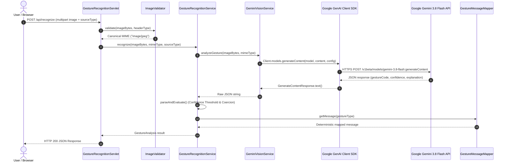

# GestureTalk AI — Google Gemini Multimodal AI Integration

| Document Metadata | Value |
| :--- | :--- |
| **Document ID** | AI-01 |
| **Project Name** | GestureTalk AI |
| **Version** | 1.0.0 (Production Release) |
| **Classification** | AI Integration, Vision Pipeline & Prompt Specification |
| **Target SDK** | Official Google GenAI Java SDK (`com.google.genai:google-genai:1.80.0`) |
| **Default Model** | `gemini-3.8-flash` |

---

## 1. Executive Summary & Design Philosophy

**GestureTalk AI** leverages Google's state-of-the-art multimodal vision model to recognize human hand postures from digital image frames. The architecture is guided by three non-negotiable engineering principles:

1. **AI as a Visual Classifier, Never an Autonomous Orator**:
   Generative language models can hallucinate or produce unpredictable natural language phrasing. GestureTalk AI restricts the model to classifying visual tokens and providing brief diagnostic rationales. All user-facing vocalizations and text messages are resolved by an immutable Java dictionary ([`GestureMessageMapper.java`](file:///d:/MY%20PROJECTS/GestureTalk%20AI/src/main/java/com/gesturetalk/service/GestureMessageMapper.java)).

2. **In-Memory Ephemeral Data Flow**:
   User camera frames and file uploads remain exclusively in JVM volatile memory (`byte[]`). Images are transmitted to Gemini as Base64-encoded `Blob` payloads over TLS and discarded immediately after request processing. No image frames are written to local disk, temporary storage, or the database.

3. **Zero Frontend Secret Exposure**:
   Client-side JavaScript never communicates directly with the Gemini API. All interactions pass through the authenticated server-side controller ([`GestureRecognitionServlet.java`](file:///d:/MY%20PROJECTS/GestureTalk%20AI/src/main/java/com/gesturetalk/controller/GestureRecognitionServlet.java)), keeping the `GOOGLE_API_KEY` hidden within backend environment variables.

---

## 2. Google GenAI Java SDK Architecture

The integration utilizes the official Google GenAI Java SDK (`com.google.genai:google-genai:1.80.0`), instantiated within [`GeminiVisionService.java`](file:///d:/MY%20PROJECTS/GestureTalk%20AI/src/main/java/com/gesturetalk/service/GeminiVisionService.java).



### SDK Client Initialization

```java
// GeminiVisionService.java
String apiKey = resolveApiKey(); // Reads GOOGLE_API_KEY
String configuredModel = System.getenv("GEMINI_MODEL");
this.modelName = (configuredModel != null && !configuredModel.isBlank()) 
    ? configuredModel.trim() 
    : DEFAULT_MODEL; // "gemini-3.8-flash"

this.client = Client.builder().apiKey(apiKey).build();
```

---

## 3. Multimodal Payload Construction

Multimodal inputs combine textual prompt instructions with binary image data. The request is structured using SDK fluent builders:

```java
// 1. Build Blob and Part for image directly from in-memory byte[]
Blob imageBlob = Blob.builder()
        .mimeType(mimeType)
        .data(imageBytes)
        .build();

Part imagePart = Part.builder()
        .inlineData(imageBlob)
        .build();

// 2. Build text instruction Part
Part textPart = Part.builder()
        .text(CLASSIFICATION_PROMPT)
        .build();

// 4. Assemble Content container
Content content = Content.builder()
        .parts(Arrays.asList(textPart, imagePart))
        .build();

// 5. Enforce structured JSON and low temperature
GenerateContentConfig config = GenerateContentConfig.builder()
        .responseMimeType("application/json")
        .temperature(0.2f)
        .build();

GenerateContentResponse response = client.models.generateContent(modelName, content, config);
```

---

## 4. Prompt Engineering & Output Schema

The prompt enforces strict single-gesture taxonomy and mandatory JSON formatting:

### Classification Prompt

```text
You are an expert computer vision system for hand gesture recognition.
Analyze the provided image and classify the primary hand gesture shown.
You MUST classify the gesture into EXACTLY ONE of the following codes:
1. "THUMBS_UP"      - Closed fist with thumb pointing straight upward.
2. "THUMBS_DOWN"    - Closed fist with thumb pointing straight downward.
3. "OPEN_PALM"      - Flat open hand with all 5 digits extended facing camera.
4. "V_SIGN"         - Index and middle fingers extended in a V-shape; other fingers folded.
5. "INDEX_POINTING" - Single index finger extended pointing; thumb and other fingers folded.
6. "UNKNOWN"        - If no hand is visible, multiple hands show conflicting signs,
the hand is blurred/occluded, or the gesture does not unambiguously match the 5 above.

You must output STRICT JSON with this exact schema:
{
  "gestureCode": "THUMBS_UP | THUMBS_DOWN | OPEN_PALM | V_SIGN | INDEX_POINTING | UNKNOWN",
  "confidence": 0.0 to 1.0,
  "explanation": "Brief 1-sentence description of the observed hand posture."
}
```

---

## 5. Supported Gesture Taxonomy & Spoken Phrases

| Gesture Code | Gesture Name | Visual Criteria | Mapped Natural Language Message | Auto-Speak |
| :--- | :--- | :--- | :--- | :---: |
| `THUMBS_UP` | Thumbs Up | Fist closed, thumb pointing vertically upward | *"Yes, that's correct."* | Yes |
| `THUMBS_DOWN` | Thumbs Down | Fist closed, thumb pointing vertically downward | *"No, that's incorrect."* | Yes |
| `OPEN_PALM` | Open Palm | Hand open, all five fingers extended facing camera | *"Please stop or wait."* | Yes |
| `V_SIGN` | Victory / Peace | Index and middle fingers extended in V; others closed | *"Peace and greetings."* | Yes |
| `INDEX_POINTING` | Index Pointing | Index finger extended pointing; other digits folded | *"Please look there."* | Yes |
| `UNKNOWN` | Unknown Gesture | Blurred, occluded, ambiguous, or unlisted gesture | *"Gesture not recognized. Please try again."* | **No** |

---

## 6. Safety Threshold & Confidence Coercion

Model confidence is a continuous float ($0.0 \le c \le 1.0$). To prevent false positives and unintentional vocalizations:

1. **Default Threshold ($0.75$)**: Configurable via the `CONFIDENCE_THRESHOLD` environment variable ($0.0$ to $1.0$).
2. **Coercion Rule**: If a recognized gesture code is returned (e.g. `THUMBS_UP`) but the estimated confidence is $< 0.75$, the result is **automatically coerced to `UNKNOWN`**:
   ```java
   boolean meetsThreshold = (confidence >= this.confidenceThreshold);
   if (!meetsThreshold && parsedType != GestureType.UNKNOWN) {
       finalGestureType = GestureType.UNKNOWN;
       explanation = String.format(
           "Confidence (%.1f%%) fell below the required %.0f%% reliability threshold.",
           confidence * 100.0, this.confidenceThreshold * 100.0);
   }
   ```
3. **Auto-Vocalization Gate**: Automatic speech playback is **never** permitted for `UNKNOWN` gestures or results below the confidence threshold:
   ```java
   public boolean isAutoSpeakAllowed(GestureType gestureType, boolean meetsThreshold) {
       if (gestureType == null || gestureType == GestureType.UNKNOWN) {
           return false;
       }
       return meetsThreshold;
   }
   ```

---

## 7. Error Handling & Resilience Matrix

The service maps all upstream SDK and Google API exceptions to specific HTTP status codes and user-safe diagnostics:

| Exception Scenario | Upstream Error Pattern | Mapped Error Code | HTTP Status | User Message |
| :--- | :--- | :--- | :---: | :--- |
| **Rate Limit / Quota** | `429`, `RESOURCE_EXHAUSTED` | `AI_RATE_LIMIT` | `503 Service Unavailable` | "Gemini API rate limit or quota exceeded. Please retry in a few seconds." |
| **Authentication** | `401`, `403`, `API_KEY_INVALID` | `AI_AUTH_ERROR` | `500 Internal Server Error` | "Invalid or unauthorized GOOGLE_API_KEY provided to Gemini API." |
| **Network Timeout** | `timeout`, `timed out` | `AI_TIMEOUT` | `504 Gateway Timeout` | "Gemini Vision API connection timed out. Please retry." |
| **Empty Response** | Null or blank response text | `AI_EMPTY_RESPONSE` | `502 Bad Gateway` | "Gemini Vision API returned an empty classification response." |
| **Malformed JSON** | `JsonSyntaxException` from model | Fallback Handler | `200 OK` (Safe Fallback) | Coerces to `UNKNOWN` with explanatory diagnosis. |

### Secret Redaction in Logs
Error messages undergo regex sanitization before being logged to prevent accidental exposure of API keys:
```java
private static String sanitizeErrorMessage(String msg) {
    if (msg == null) return "Unknown AI service error.";
    return msg.replaceAll("(?i)(key|api[_-]?key)=([a-zA-Z0-9_\\-]+)", "$1=REDACTED");
}
```

---

## 8. Testability & Offline Mock Provider

To support automated CI/CD and offline unit testing without incurring Gemini API costs or requiring live credentials, the service exposes an interface:

```java
public interface VisionService {
    String analyzeGesture(byte[] imageBytes, String mimeType);
    String getModelName();
}
```

During testing, [`MockVisionService.java`](file:///d:/MY%20PROJECTS/GestureTalk%20AI/src/test/java/com/gesturetalk/service/MockVisionService.java) simulates live Gemini responses with customizable latency, deterministic confidence scores, and error scenarios.

