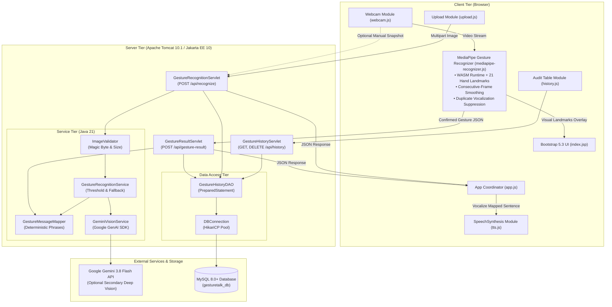
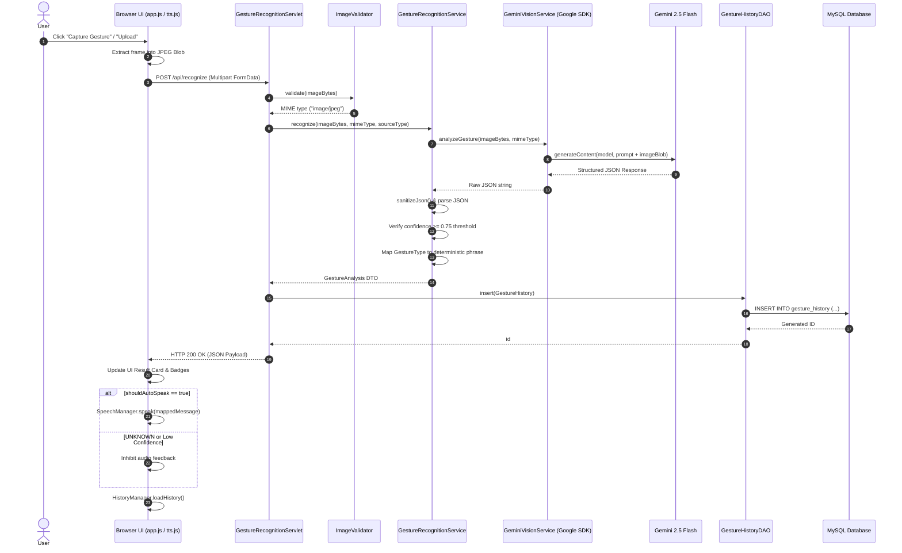

# GestureTalk AI — Architecture Specification

| Document Metadata | Value |
| :--- | :--- |
| **Document ID** | ARCH-01 |
| **Project Name** | GestureTalk AI |
| **Version** | 1.1.0 (MediaPipe Real-Time Architecture Release) |
| **Classification** | System & Software Architecture Document |
| **Target Runtime** | Java 21 LTS / Jakarta EE 10 / Apache Tomcat 10.1+ / WebAssembly |

---

## 1. System Overview & Architectural Philosophy

**GestureTalk AI** is an AI-powered hand gesture recognition and assistive text-to-speech web application built on **pure Java 21 LTS**, **Jakarta EE 10**, **Apache Tomcat 10.1**, and **Google MediaPipe Gesture Recognizer for Web (WebAssembly)**.

### Core Architectural Principles:
1. **Hybrid Architecture (Client-Side Real-Time + Java Backend)**:
   - **Primary Engine**: Real-time webcam tracking runs in the client browser using Google MediaPipe Gesture Recognizer (`@mediapipe/tasks-vision`) compiled to WebAssembly. Zero video frames are transmitted over external networks for webcam recognition, eliminating latency and cloud API quota bottlenecks.
   - **Java Backend Authority**: All gesture validation, deterministic natural language mapping, and database persistence are strictly enforced by Java Servlets (`GestureResultServlet`, `GestureRecognitionServlet`).
2. **Deterministic Natural Language Mapping**: The generative AI model and visual classifier perform visual classification only; user-facing sentences are deterministically resolved by immutable Java logic in `GestureMessageMapper.java`.
3. **Resilience & Zero 503 Downtime**: The application operates fully even if Gemini Vision returns HTTP 503, has rate limits, or is unconfigured. MediaPipe runs locally without external API dependencies.
4. **In-Memory Volatile Processing**: Uploaded frames and camera snapshots exist exclusively in volatile memory (`byte[]` buffers). Zero image bytes are ever written to disk or stored in the database.
5. **Strict Separation of Concerns (MVC)**: Clean boundary enforcement between View (JSP, HTML5, CSS3, vanilla JS), Controller (Jakarta Servlets), Service (Domain Logic & AI Orchestration), Model (DTOs and Entities), and DAO (JDBC PreparedStatement Layer).
6. **Privacy & Credential Isolation**: The optional Google GenAI API key (`GOOGLE_API_KEY`) and database credentials are read exclusively from environment variables on the server. No secrets are ever exposed to client-side scripts.

---

## 2. High-Level Architecture Diagram



    CAM -->|Rasterize Blob| APP
    UPL -->|Select File| APP
    APP -->|Multipart POST| REC_SERV
    HIST -->|Fetch / Clear| HIST_SERV

    REC_SERV --> VAL
    VAL -->|Validated Bytes| REC_SVC
    REC_SVC --> GEMINI
    GEMINI -->|JSON Over HTTPS| GEMINI_API
    GEMINI_API -->|Structured JSON| GEMINI
    REC_SVC --> MAP
    REC_SERV -->|Audit Entity| DAO
    DAO --> POOL
    POOL -->|JDBC TCP| MYSQL

    HIST_SERV --> DAO

    REC_SERV -->|JSON Payload| APP
    APP -->|Spoken Phrase| TTS
```

---

## 3. Tier & Component Breakdown

### 3.1 Presentation Tier (View)
* **[`index.jsp`](file:///d:/MY%20PROJECTS/GestureTalk%20AI/src/main/webapp/index.jsp)**: Single-page responsive view styled with dark AI theme, viewport-adaptive containers, and accessibility attributes (`aria-live`, semantic badges).
* **[`webcam.js`](file:///d:/MY%20PROJECTS/GestureTalk%20AI/src/main/webapp/static/js/webcam.js)**: Manages `navigator.mediaDevices.getUserMedia` video stream and performs off-screen HTML5 `<canvas>` snapshot rasterization.
* **[`upload.js`](file:///d:/MY%20PROJECTS/GestureTalk%20AI/src/main/webapp/static/js/upload.js)**: Handles drag-and-drop file ingestion, file signature validation, and instant preview.
* **[`tts.js`](file:///d:/MY%20PROJECTS/GestureTalk%20AI/src/main/webapp/static/js/tts.js)**: Native `window.speechSynthesis` wrapper supporting voice selection, speech rate/pitch sliders, replay queue, and speaking state badges.
* **[`history.js`](file:///d:/MY%20PROJECTS/GestureTalk%20AI/src/main/webapp/static/js/history.js)**: Manages audit log table rendering, gesture filtering, and confirmed history purging.
* **[`app.js`](file:///d:/MY%20PROJECTS/GestureTalk%20AI/src/main/webapp/static/js/app.js)**: Central frontend coordinator; enforces in-flight duplicate request suppression and coordinates recognition dispatching.

### 3.2 Controller Tier (Jakarta Servlets)
* **[`GestureRecognitionServlet.java`](file:///d:/MY%20PROJECTS/GestureTalk%20AI/src/main/java/com/gesturetalk/controller/GestureRecognitionServlet.java)**:
  - Mapped to `POST /api/recognize`.
  - Configured with `@MultipartConfig` (5 MB max file, 6 MB max request).
  - Validates image magic bytes via [`ImageValidator`](file:///d:/MY%20PROJECTS/GestureTalk%20AI/src/main/java/com/gesturetalk/util/ImageValidator.java).
  - Invokes [`GestureRecognitionService`](file:///d:/MY%20PROJECTS/GestureTalk%20AI/src/main/java/com/gesturetalk/service/GestureRecognitionService.java).
  - Persists audit logs asynchronously to MySQL via [`HistoryDAO`](file:///d:/MY%20PROJECTS/GestureTalk%20AI/src/main/java/com/gesturetalk/dao/HistoryDAO.java).
* **[`GestureHistoryServlet.java`](file:///d:/MY%20PROJECTS/GestureTalk%20AI/src/main/java/com/gesturetalk/controller/GestureHistoryServlet.java)**:
  - Mapped to `/api/history`.
  - `GET /api/history`: Returns latest $N$ records, optionally filtered by `?gesture=`.
  - `DELETE /api/history`: Clears audit records and returns deleted count.
  - `POST /api/history`: Handles fallback method overrides (`_method=DELETE`).

### 3.3 Service Tier (Business & AI Logic)
* **[`GestureRecognitionService.java`](file:///d:/MY%20PROJECTS/GestureTalk%20AI/src/main/java/com/gesturetalk/service/GestureRecognitionService.java)**:
  - Dispatches image bytes to the active [`VisionService`](file:///d:/MY%20PROJECTS/GestureTalk%20AI/src/main/java/com/gesturetalk/service/VisionService.java).
  - Strips markdown code fences from JSON output.
  - Enforces the configurable confidence threshold (default $0.75$). Coerces borderline ($< 0.75$) and ambiguous outputs to `UNKNOWN`.
  - Integrates [`GestureMessageMapper`](file:///d:/MY%20PROJECTS/GestureTalk%20AI/src/main/java/com/gesturetalk/service/GestureMessageMapper.java) for deterministic phrase assignment and auto-speech authorization.
* **[`GeminiVisionService.java`](file:///d:/MY%20PROJECTS/GestureTalk%20AI/src/main/java/com/gesturetalk/service/GeminiVisionService.java)**:
  - Communicates with Google Gemini Vision via the official SDK (`com.google.genai.Client`).
  - Converts volatile image bytes to base64 `Blob` within a structured multimodal prompt.
  - Intercepts and categorizes exceptions (429 rate limits, timeouts, invalid keys) into domain-specific [`AIServiceException`](file:///d:/MY%20PROJECTS/GestureTalk%20AI/src/main/java/com/gesturetalk/exception/AIServiceException.java).
  - Sanitizes log output to ensure API keys are never leaked.
* **[`VisionService.java`](file:///d:/MY%20PROJECTS/GestureTalk%20AI/src/main/java/com/gesturetalk/service/VisionService.java) & [`MockVisionService.java`](file:///d:/MY%20PROJECTS/GestureTalk%20AI/src/main/java/com/gesturetalk/service/MockVisionService.java)**:
  - Pluggable provider interface enabling complete offline unit testing and automated benchmarking without live network dependencies.
* **[`GestureMessageMapper.java`](file:///d:/MY%20PROJECTS/GestureTalk%20AI/src/main/java/com/gesturetalk/service/GestureMessageMapper.java)**:
  - Immutable Java mapping table from [`GestureType`](file:///d:/MY%20PROJECTS/GestureTalk%20AI/src/main/java/com/gesturetalk/model/GestureType.java) to natural language sentences.

### 3.4 Data Access Tier (JDBC)
* **[`DBConnection.java`](file:///d:/MY%20PROJECTS/GestureTalk%20AI/src/main/java/com/gesturetalk/config/DBConnection.java)**:
  - Configures **HikariCP** (`HikariDataSource`) connection pool (max pool size: 10, connection timeout: 3000 ms).
  - Resolves credentials via environment variables (`DB_URL`, `DB_USER`, `DB_PASSWORD`, `DB_DRIVER`).
  - Supports dynamic `DataSource` substitution for H2 in-memory testing.
* **[`GestureHistoryDAO.java`](file:///d:/MY%20PROJECTS/GestureTalk%20AI/src/main/java/com/gesturetalk/dao/GestureHistoryDAO.java)**:
  - 100% parameterized JDBC `PreparedStatement` executions.
  - Implements [`HistoryDAO`](file:///d:/MY%20PROJECTS/GestureTalk%20AI/src/main/java/com/gesturetalk/dao/HistoryDAO.java) interface.
  - Operates on the `gesture_history` table.

---

## 4. End-to-End Sequence Diagram



---

## 5. Security Architecture

| Security Domain | Applied Architectural Measure |
| :--- | :--- |
| **API Key Protection** | Server-side environment variable only (`GOOGLE_API_KEY`). Regex log scrubbing redacts credentials before log output. |
| **File Upload Validation** | Strict binary header inspection (magic bytes for JPEG `FF D8 FF`, PNG `89 50 4E 47`, WebP `RIFF...WEBP`). Claimed `Content-Type` is never trusted. Executable binaries (`.exe`, `.pdf`, `.zip`, `.elf`) rejected with HTTP 415. |
| **Size Constraint** | Maximum file size strictly enforced at $5 \text{ MB}$ ($5,242,880 \text{ bytes}$) with HTTP 413 rejection. |
| **Volatile Processing** | All frames read into in-memory `byte[]` streams. No disk files created. |
| **SQL Injection Prevention** | 100% parameterized JDBC `PreparedStatement` with bound placeholders (`?`). |
| **XSS Prevention** | Client rendering uses `.textContent` and HTML escaping for all dynamic model outputs. |
| **In-Flight Guarding** | Duplicate request prevention flags block overlapping clicks while an AI request is in progress. |

