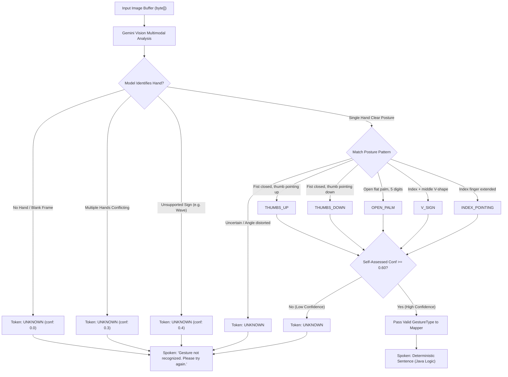

# GestureTalk AI — Application Workflow Flowcharts

| Diagram Document | Value |
| :--- | :--- |
| **Document ID** | DIAG-02 |
| **Project Name** | GestureTalk AI |
| **Classification** | Process & Flowchart Diagrams (Mermaid) |
| **Parent Document** | [../05-APPLICATION-WORKFLOW.md](../05-APPLICATION-WORKFLOW.md) |

---

## 1. End-to-End Processing Workflow Flowchart

```mermaid
flowchart TD
    Start(["User Initiates Interaction"]) --> Choice{"Select Ingestion Mode"}

    %% Ingestion Branch
    Choice -->|"Live Camera"| CamStart["Click 'Start Camera'"]
    CamStart --> Stream["Stream Viewfinder via MediaDevices"]
    Stream --> HandPos["User Performs Hand Gesture"]
    HandPos --> Snap["Click 'Capture Gesture'"]
    Snap --> Canvas["Rasterize Frame to HTML5 Canvas"]
    Canvas --> Blob["Convert to JPEG Blob in FormData"]

    Choice -->|"File Upload"| DragDrop["Select or Drag-and-Drop Image"]
    DragDrop --> FileCheck{"Client Size Check <= 5MB"}
    FileCheck -->|"Exceeds 5MB"| FileErr["Display Client Alert"]
    FileCheck -->|"Valid"| FileBlob["Attach File to FormData"]

    %% Network Dispatch
    Blob --> HTTP["Fetch POST /api/recognize (Multipart)"]
    FileBlob --> HTTP

    %% Server Servlet Layer
    HTTP --> Servlet["GestureRecognitionServlet Receives Request"]
    Servlet --> Extract["Read File Stream into Volatile byte array (RAM)"]

    %% Server Validation Layer
    Extract --> ValidGuard{"ImageValidationService Checks"}
    ValidGuard -->|"Size > 5MB"| Err413["HTTP 413: FILE_TOO_LARGE"]
    ValidGuard -->|"Bad Magic Bytes"| Err415["HTTP 415: INVALID_IMAGE_FORMAT"]
    ValidGuard -->|"Valid Format & Size"| AICall["GeminiVisionService Prepares Payload"]

    %% AI Integration Layer
    AICall --> PartBytes["Create Part.fromBytes(imageBytes) + Prompt"]
    PartBytes --> CloudGenAI["Dispatch Request to Google Gemini Developer API"]
    CloudGenAI --> AIResp["Receive Raw JSON Output"]
    AIResp --> ParseJSON["Parse JSON with Gson (gesture, conf, reason)"]

    %% Classification Logic Layer
    ParseJSON --> ConfCheck{"Confidence >= 0.60 AND Known Gesture?"}
    ConfCheck -->|"NO (Ambiguous/Low Conf)"| SetUnknown["Assign GestureType.UNKNOWN"]
    ConfCheck -->|"YES (Recognized Sign)"| SetKnown["Assign Recognized GestureType Token"]

    %% Deterministic Mapping Layer
    SetUnknown --> MapUnknown["Map to: 'Gesture not recognized. Please try again.'"]
    SetKnown --> MapKnown["Map to Deterministic Predefined Spoken Sentence"]

    %% Database Layer
    MapUnknown --> DBInsert["Insert Audit Record into MySQL gesture_history"]
    MapKnown --> DBInsert

    %% Response Delivery Layer
    DBInsert --> RespJSON["Build Structured JSON Response Payload"]
    RespJSON --> Send200["Send HTTP 200 OK to Browser Client"]

    %% Client Frontend & Speech Layer
    Send200 --> ClientReceive["Browser JavaScript Receives JSON"]
    ClientReceive --> UpdateUI["Render Gesture Badge, Text & Confidence Bar"]
    UpdateUI --> VoiceSynth["Invoke window.speechSynthesis.speak()"]
    VoiceSynth --> Vocalize(["Device Speakers Vocalize Message"])

    %% Error Returns to UI
    Err413 --> ShowErr["Display Error Toast in Browser"]
    Err415 --> ShowErr
```

---

## 2. Decision Logic for Gesture Classification & Fallback

---

## 3. Document Cross-References

* Workflow documentation: [../05-APPLICATION-WORKFLOW.md](../05-APPLICATION-WORKFLOW.md)
* Sequence interactions: [sequence-diagram.md](sequence-diagram.md)
* Error mitigation: [../13-ERROR-HANDLING-AND-VALIDATION.md](../13-ERROR-HANDLING-AND-VALIDATION.md)

