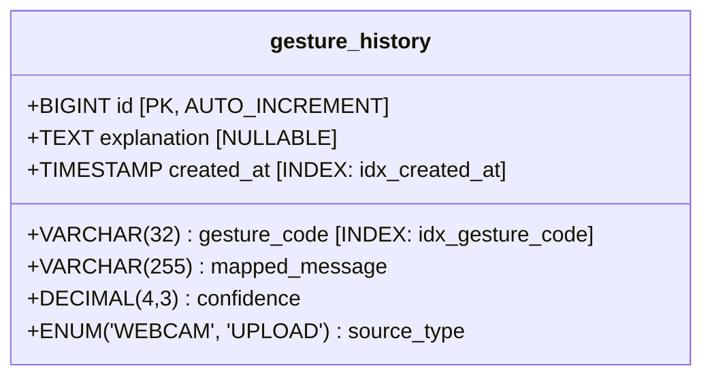

# GestureTalk AI — Database Entity-Relationship (ER) Diagram

| Diagram Document | Value |
| :--- | :--- |
| **Document ID** | DIAG-04 |
| **Project Name** | GestureTalk AI |
| **Classification** | Relational Data Model (Mermaid ER) |
| **Database Name** | `gesturetalk_db` |
| **Parent Document** | [../10-DATABASE-DESIGN.md](../10-DATABASE-DESIGN.md) |

---

## 1. Entity-Relationship Diagram

```mermaid
erDiagram
    GESTURE_HISTORY {
        bigint id PK "Auto-incrementing primary key"
        varchar(32) gesture_code "Gesture token (THUMBS_UP, OPEN_PALM, etc.)"
        varchar(255) mapped_message "Deterministic natural language sentence"
        text explanation "Model qualitative reasoning / description"
        decimal(4,3) confidence "Self-assessed confidence score (0.000 to 1.000)"
        enum source_type "'WEBCAM' or 'UPLOAD'"
        timestamp created_at "Timestamp of recognition event (UTC)"
    }
```

---

## 2. Table Indexing & Physical Storage Specification



### Physical Index Architecture:
1. **Primary Key**: `PRIMARY KEY (id)` — B-Tree index providing $O(\log N)$ point lookups by generated ID.
2. **Gesture Filter Index**: `INDEX idx_gesture_code (gesture_code)` — Optimizes history queries filtering by specific gesture (e.g., `WHERE gesture_code = 'THUMBS_UP'`).
3. **Temporal Ordering Index**: `INDEX idx_created_at (created_at)` — Accelerates reverse chronological audit retrieval (`ORDER BY created_at DESC LIMIT 50`).

---

## 3. Data Dictionary Summary

* **Engine**: `InnoDB`
* **Charset**: `utf8mb4`
* **Collation**: `utf8mb4_unicode_ci`
* **Row Count Projection**: Lightweight audit logging; historical rows can be cleared at will via `DELETE /api/history`.

---

## 4. Document Cross-References

* Database design documentation: [../10-DATABASE-DESIGN.md](../10-DATABASE-DESIGN.md)
* DAO implementation details: [../04-SYSTEM-ARCHITECTURE.md](../04-SYSTEM-ARCHITECTURE.md)
* Security and SQL injection prevention: [../12-SECURITY-AND-PRIVACY.md](../12-SECURITY-AND-PRIVACY.md)

