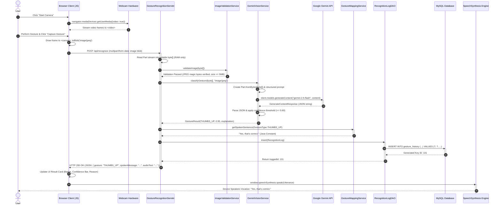
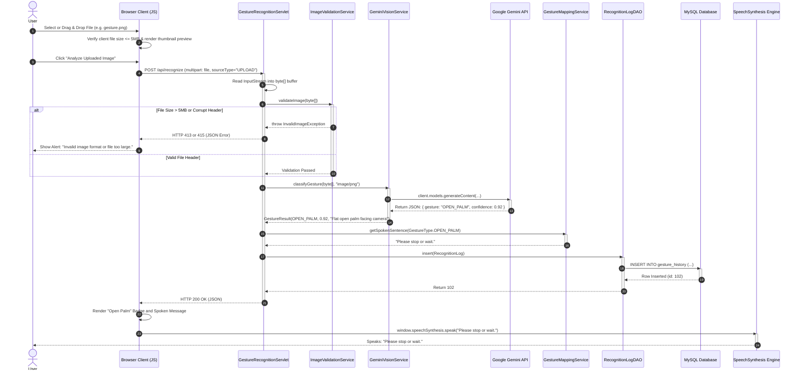

# GestureTalk AI — Sequence Diagrams

| Diagram Document | Value |
| :--- | :--- |
| **Document ID** | DIAG-03 |
| **Project Name** | GestureTalk AI |
| **Classification** | Interaction & Protocol Diagrams (Mermaid) |
| **Parent Document** | [../05-APPLICATION-WORKFLOW.md](../05-APPLICATION-WORKFLOW.md) |

---

## 1. Webcam-to-Gemini Real-Time Recognition Sequence

---

## 2. Static Image Upload Sequence Diagram

---

## 3. Document Cross-References

* Workflow documentation: [../05-APPLICATION-WORKFLOW.md](../05-APPLICATION-WORKFLOW.md)
* API endpoint specifications: [../09-API-ENDPOINT-DESIGN.md](../09-API-ENDPOINT-DESIGN.md)
* Visual system architecture: [system-architecture.md](system-architecture.md)

