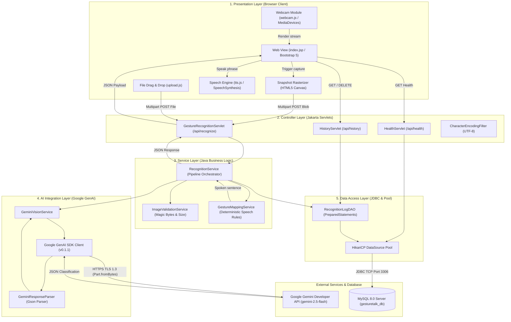
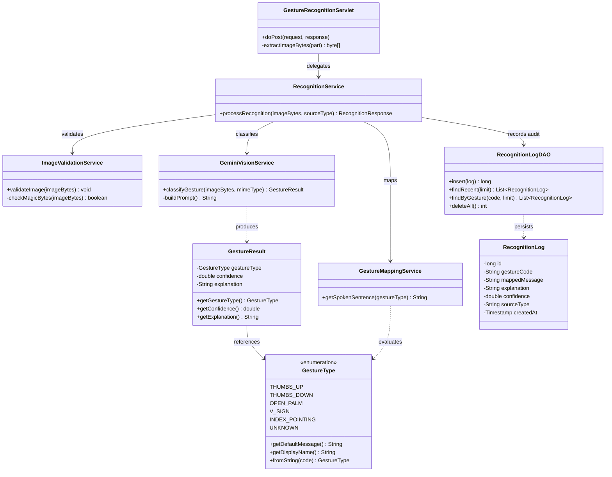

# GestureTalk AI — System Architecture Diagrams

| Diagram Document | Value |
| :--- | :--- |
| **Document ID** | DIAG-01 |
| **Project Name** | GestureTalk AI |
| **Classification** | Architectural Diagrams (Mermaid) |
| **Parent Document** | [../04-SYSTEM-ARCHITECTURE.md](../04-SYSTEM-ARCHITECTURE.md) |

---

## 1. Layered System Architecture Diagram

---

## 2. MVC Component Relationship Diagram

---

## 3. Document Cross-References

* High-level architectural specifications: [../04-SYSTEM-ARCHITECTURE.md](../04-SYSTEM-ARCHITECTURE.md)
* Application workflows: [application-workflow.md](application-workflow.md)
* Sequence diagrams: [sequence-diagram.md](sequence-diagram.md)

